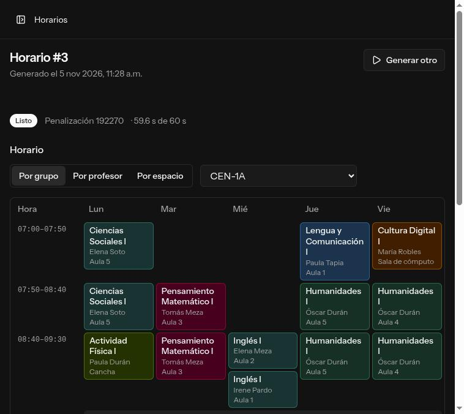

# Web (`apps/web`)

Aplicación Laravel 13 + Inertia 3 + Vue 3 (starter kit oficial de Vue) para capturar o importar los datos de cada escuela, generar horarios con el motor (`apps/solver`) y verlos.

## Desarrollo local

Requisitos: PHP 8.3+ con `pdo_pgsql`, Composer, Node 22+ y Docker.

```bash
# Postgres (puerto 5433 del host) y el motor (puerto 8000), desde la raíz del repo
docker compose up -d postgres solver

cd apps/web
cp .env.example .env
php artisan key:generate
composer install && npm install
php artisan migrate
composer dev                                 # servidor, Vite, logs y la cola (el job que llama al motor)
```

`.env.example` apunta a ese Postgres (`DB_PORT=5433`) y al motor (`SOLVER_URL=http://localhost:8000`, `SOLVER_TOKEN=dev`). Para trabajar sin Docker, usa `DB_CONNECTION=sqlite`.

## Pruebas y calidad

```bash
composer ci:check   # oxlint/oxfmt (vp check), vue-tsc, Pint, PHPStan y PHPUnit
npm run test        # Vitest (vp test)
```

Las pruebas de PHP usan SQLite en memoria (`phpunit.xml`).

## Escuela demo

```bash
php artisan demo:cargar --password=demo-local
```

Crea «Prepa Horizonte» a partir del problema de demostración del motor (`contracts/fixtures/demo/prepa-horizonte.json`): 3 planteles, 27 espacios, 3 plantillas, 57 materias, 39 grupos, 81 profesores con su disponibilidad y 333 cursos, en el ciclo actual `2026B`. Entra con `admin@prepa-horizonte.test`. Sin `--password`, genera una contraseña y la muestra una sola vez. Si ese correo ya existe, no toca nada; usa `--correo` para otra copia.

## Excel

En **Escuela → Excel** se baja la plantilla (vacía o con los datos de la escuela) y se sube de vuelta:

- **Plantilla de Horarios:** hojas Planteles, Espacios, Plantillas, Materias, Grupos, Profesores, Disponibilidad y Carga, con listas desplegables y una hoja de instrucciones.
- **Carga horaria de UTEG:** la hoja `HORARIOS` (una fila por grupo y materia). Se eligen el plantel, la plantilla de 1.º y 2.º, la de 3.º a 6.º y el plan; `GENERICO` es un curso vacante.

Antes de aplicar se ve cuántos registros se crean y cuántos cambian, con los errores por hoja, fila y columna. Con errores no se aplica nada; sin errores se aplica todo en una transacción. Importar nunca borra y reimportar el mismo archivo no duplica.

## Verificación del flujo de la fase 2

Hecha el 2026-11-05 con el motor real en Docker (`docker compose up -d postgres solver`) y la web en local:

1. `php artisan demo:cargar --password=demo-local` y, como su admin, **Mis datos en Excel**.
2. Otra escuela desde el registro, con su ciclo, importando ese Excel. La vista previa no tuvo errores: 3 planteles, 27 espacios, 86 franjas, 57 materias, 39 grupos, 81 profesores, 50 filas de disponibilidad y 333 cursos, más los avisos de las plantillas, el plan y las 9 sincronías que se crean.
3. **Generar** con el tiempo por omisión (60 s) y `php artisan queue:work --timeout=1000`.

Resultado: la corrida terminó en `ok` en 61 s (59.6 s del motor, CP-SAT `FEASIBLE`) con 630 sesiones; la página se actualizó sola y la cuadrícula muestra el horario de cada grupo, profesor y espacio.


